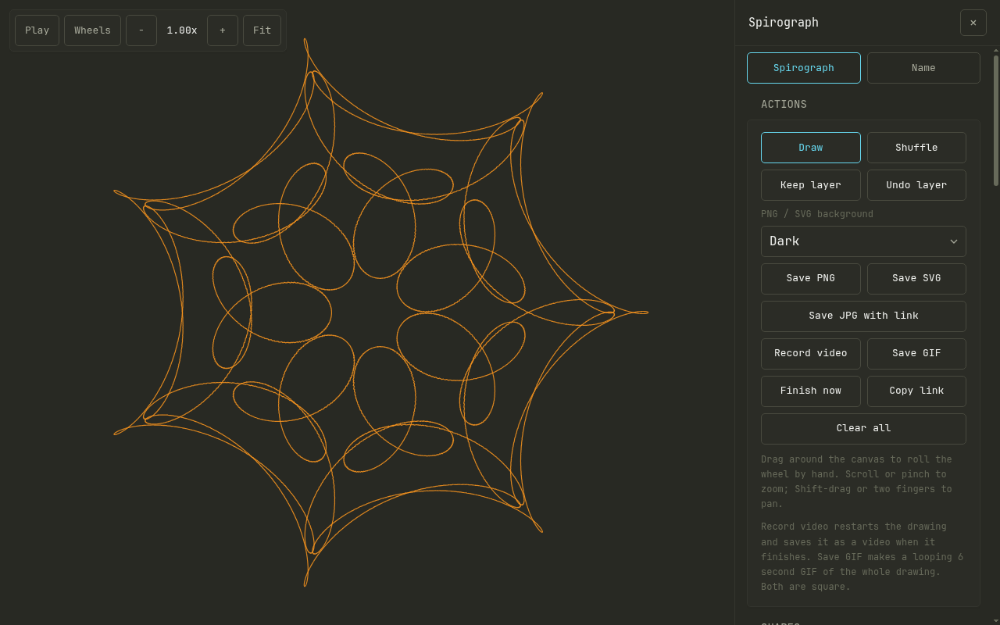
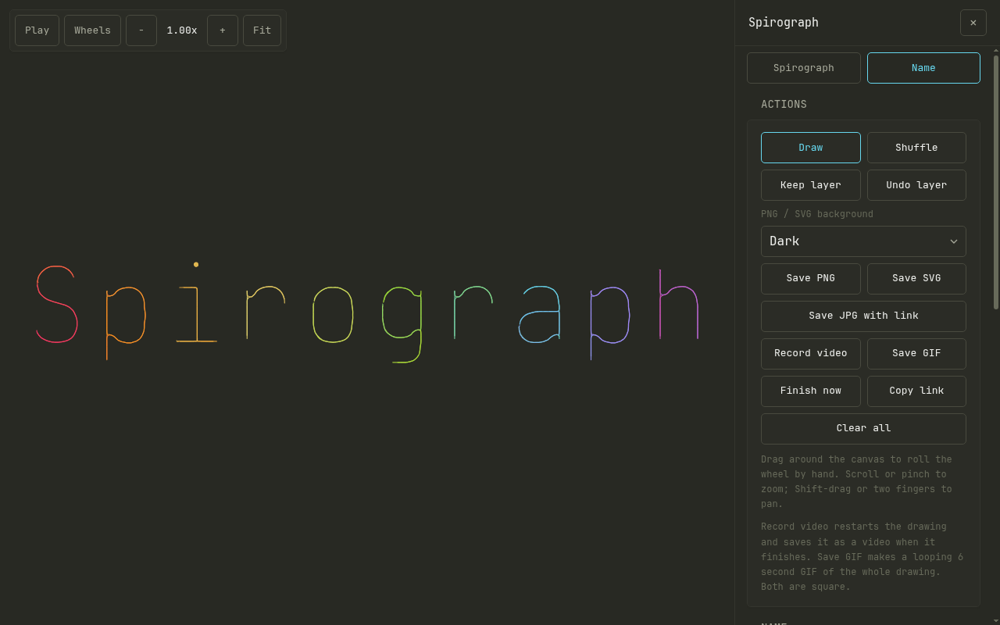

<div align="center">

# Spirograph

**Draw spirograph patterns in the browser, then turn your name into a chain of spinning circles.**

[**Open the app**](https://spiro.ianmcmanus.net) · [Features](#features) · [Controls](#controls) · [How it works](#how-it-works) · [Self-host](#run-locally)


</div>

One HTML file, no dependencies, no build step, no tracking, no server-side state. It runs on desktop and phones, installs to a home screen, and works offline.

| Wheels shown while rolling | Second wheel | Name as epicycles |
| --- | --- | --- |
|  |  |  |

## Features

### Spirograph mode

- **11 shapes for both ring and wheel:** circle, ellipse, squircle, heart, rosette, triangle, square, pentagon, hexagon, star and burst, in any combination.
- **Inside or outside** rolling, the same as the physical kit.
- **Real gear sizing:** pick tooth counts from the classic kit (rings 96, 105, 144, 150; wheels 24 to 84) so patterns close the way real gears do, or size by percentage.
- **Exact closure:** the app finds when the pen returns to its start and stops there. Patterns close with no visible seam.
- **Corner-aware rolling:** a round wheel rolls round a sharp corner on a fillet instead of cutting through the ring. Wheels with corners pivot about each vertex, as a real gear would.
- **Second wheel:** ride a smaller wheel on the rolling wheel, outside or inside, with its own size (1/2 to 1/12 of the wheel) and orbit speed (1x to 12x). The pen moves onto the second wheel. This gives orbiting-lobe patterns a normal kit can't make. Fit to screen shrinks the ring so the pen stays in view.
- **Pen radius** from 0 to 150% of the wheel, so the pen can sit inside the wheel, on its edge, or beyond it.
- **Layers:** Keep layer freezes the current pattern and the next one draws on top. Undo layer removes the last. Rotation turns the whole pattern for rotated copies across layers.
- **Ink:** a palette of swatches (the six Monokai colours, white and the colour cycle) plus a custom colour picker, one per layer. The cycle has an adjustable hue offset. Line weight 0.5 to 4.
- **Gallery of 15 presets,** from the classic 96/52 to second-wheel patterns. Picking one draws it.
- **Shuffle** picks a random combination of shapes, sizes, pen and colour, including long-running patterns and (one time in five) a second wheel.
- **Hands-on drawing:** drag around the canvas to roll the wheel by hand. Drag backwards to erase.

### Name mode

Type a name and press Play. A chain of rotating circles (a Fourier series of the letter strokes) writes it out, drawn from the real outlines of JetBrains Mono.

- Up to 80 characters.
- Long text wraps onto several lines on portrait screens, sized to the screen.
- The Circles slider sets how many circles draw the text, from 2 to 16000 (up to what the text or picture has): a rough sketch at the low end, sharp letters at the high end.
- Wheels shows the whole chain of circles and arms while it writes.

### Image mode

Upload a picture and its edges are traced as one line, then drawn by the same chain of rotating circles.

- Works best on logos, silhouettes, icons, signatures and clear outlines; busy photos give a tangle.
- **Edge threshold** sets how strong an edge has to be, and **Detail** sets the resolution of the trace (96 to 768 px). A small outline preview shows the traced path before you draw.
- **Match image colours** (on by default) colours the line with the picture's own colours, lifted to a minimum brightness so dark areas show on the dark canvas. Turn it off to use the ink palette instead. SVG, PNG, GIF and video all keep the matched colours.
- Everything runs in the browser: the image is never uploaded.
- A picture can't be carried in a share link, so Copy link restores the settings but not the image. Exports work as usual.

### View and playback

- Play, pause and speed from 0.05x to 8x.
- Scroll or pinch to zoom up to 40x; Shift-drag, middle-drag or two fingers to pan. The pattern is redrawn crisp at the new zoom once you stop.
- **Fit** frames the whole design, every layer included.
- **Wheels** overlay shows the ring, the rolling wheel, the second wheel and the pen arm.
- **Finish now** draws the rest of the pattern at once.

### Sharing and export

- **Link state:** every setting, including kept layers, lives in the URL hash as a short packed code (`#p=...`, only what differs from the defaults). Reload keeps your work. **Copy link** shares it (the share sheet on phones). Older long links still open.
- **Save PNG:** every layer at up to 4096 px.
- **Save SVG:** vector paths for print or pen plotters.
- **3D spirograph (`/3d`):** arms joined end to end, each turning about its own axis (tilt, azimuth, phase, whole-number speed) and carrying the rest; the pen is at the tip. Up to 16 arms, orbit view in Three.js as a line or a tube, "Show the arms" to see the chain follow the pen, Randomise, a link that holds the settings, PNG, a binary STL of the curve as a closed tube in millimetres for printing, and a 10 s WebM turntable. "Open in 3D" on the main page fits the finished pattern with up to 16 arms (its strongest Fourier terms, chained on parallel axes, second arm tilted out of the plane). Round shapes come out as 2 arms; other shapes and the second wheel match to within a few percent of the radius (sharp corners soften). Names and pictures are not converted. **Music mode:** the Music card turns the curve into a visualiser fed by the microphone, shared tab or system audio (desktop Chrome and Edge, tick "Share tab audio"; works with the Spotify and Apple Music web players) or an audio file. Bass pulses the arm lengths, mids sway the tilt, highs shift the colour and beats kick the phases; whole-number speeds are left alone so the curve stays closed. Sensitivity and Motion sliders. Spotify and Apple Music cannot be read directly (protected audio, and Spotify's audio analysis API is closed to new apps). The view is a line while music plays. Without WebGL it falls back to a flat 2D viewer (drag to turn, scroll to zoom); `/3d?flat` forces that. Three.js is bundled into `site/vendor/three-lab.js` (rebuild: `npx esbuild server/three-entry.js --bundle --minify --format=esm --outfile=site/vendor/three-lab.js`, with `three` installed in `server/`).
- **Save JPG with link:** the design's link is written into the EXIF and XMP description. iPhone Photos shows it as the caption.
- **Background choice** for PNG and SVG: dark, white or transparent.
- **Never clipped:** exports grow to include a design that runs past the screen edge.
- **Record video:** a 1080x1080 MP4 (WebM where MP4 recording isn't supported).
- **Save GIF:** a looping 6 second 480x480 GIF of the whole drawing, encoded in the page.
- On phones, saves go through the share sheet so pictures and videos reach Photos directly. Files are named after the design, for example `Rose window - Spirograph.png`.

### App

- **Installable:** add it to a home screen for a full-screen app with its own icon. A service worker caches it for offline use.
- **Private:** no analytics, no cookies, no third-party requests. The font is bundled and the content security policy allows only the page's own files.
- **Built for phones:** on a phone the canvas is full screen with a thumb-reach dock (Play, Wheels, Fit, Shuffle, Edit). Edit opens a tabbed sheet (Design, Size, Look, Gallery, Export) that shows one group at a time with large touch targets, and the pattern shifts up so it stays visible above it. Landscape phones get a side sheet. Desktop keeps the full sidebar.
- **Editable readouts:** click the number beside any slider and type a value.
- **SEO ready:** title, description, Open Graph and Twitter cards, structured data, sitemap and robots.txt.

## Controls

| Key | Action |
| --- | --- |
| `Space` | Play / pause |
| `W` | Show / hide wheels |
| `-` / `+` | Slower / faster |
| `D` | Draw the current settings |
| `S` | Shuffle |
| `K` | Keep layer |
| `U` | Undo layer |
| `C` | Clear all |
| `F` | Finish now |
| `0` | Fit the design |

Settings changes don't redraw on their own: press Draw (or `D`). Gallery picks and Shuffle draw immediately.

## How it works

- **Geometry:** each shape is a closed polyline with cumulative arc length. The wheel rolls without slipping along the ring. The contact point, wheel centre and pen are computed per sample from arc length and turning angle, and the second wheel adds one more rotating frame.
- **Closure:** the number of laps is the smallest `k` with `k * ring perimeter ~ m * wheel perimeter` to within 1e-3, so the curve ends where it began.
- **Samples are computed lazily** as drawing reaches them, up to 250,000 per pattern. Zoom and pan scale the painted bitmaps during the gesture and restroke once it pauses.
- **Names:** the text is rasterised in JetBrains Mono, thinned to one-pixel strokes (Zhang-Suen), walked line by line into a single path, then converted to Fourier coefficients with an FFT. Drawing sums the largest circles first; the Circles slider chooses how many.
- **Exports:** PNG and SVG render from the pattern data, not from the screen. Video and GIF are rendered on a square canvas so every frame is framed the same on any device.
- **Code layout:** everything is in `site/index.html`, plus a manifest, service worker, icons and the font.

## Browser support

Current Chrome, Edge, Safari and Firefox. Video recording needs `MediaRecorder` and canvas capture; where a browser lacks them the button is disabled and everything else works.

## Deploying (Cloudflare)

The live site is the `site/` directory, served as static assets from Cloudflare; a push to `main` deploys it. `site/_headers` sets the same security headers as `nginx.conf`.

## Run locally

```sh
python3 -m http.server 8080 -d site
```

Open http://localhost:8080/.

## Homelab server build

`server/` is a second, private build for a homelab: the same page, served by a small Node server that does the heavy work itself.

- **Tracing:** names and uploaded pictures are traced into Fourier terms on the server and sent to the browser, so phones skip the thinning and FFT. The server's picture Detail goes up to 1536 px. "Clean up traced lines" drops short spurs (under about 7 px) left by the thinning.
- **Exports:** PNG (up to 8192 px, 36 megapixels), JPG, SVG, a 480 px GIF and a 1080p H.264 MP4 are rendered on the server. The MP4 is a real render of the whole drawing, not a screen capture.
- **Same code:** the geometry, FFT, tracing and stroking code is cut out of `site/index.html` between the `ENGINE-BEGIN` and `ENGINE-END` markers and run in Node with `@napi-rs/canvas`, so the server draws what the browser would. Spirograph patterns match exactly; names differ slightly because text is rasterised by Skia instead of the browser.
- **Not on the server:** the live drawing, the wheels overlay and the pattern model stay in the browser, because the animation needs them every frame.
- **Private:** it sends `noindex`, serves no service worker and has no authentication. Put it on a LAN/VPN-only hostname.

```sh
cd server
docker compose up -d --build     # http://HOST:8099/ ; LAB_PORT in .env changes the port
```

Beyond the exports, the server adds:

- **Saved designs:** the pattern, kept layers and picture are stored under `data/` and open from a short link (`/?d=ID`).
- **Background renders:** MP4 up to 4K at 60 fps, a PDF on an A4/A3/A2/Letter page (optional plain CMYK) and a plotter SVG in millimetres with one path per layer. They queue at low priority, wait in the panel, and can push a notification (ntfy and/or a webhook). The list shows progress and time left, and each job can be cancelled (queued or running) or re-run with the options currently set in the card. A plotter SVG orders its strokes (nearest end first, reversing where that is shorter) to cut pen-up travel, and takes a pen width in mm.
- **Batch of names:** a list of names becomes a zip of PNG, JPG, SVG, PDF or plotter SVG files.
- **Picture tools:** fetch a picture from a web address (the server makes the request) and split a picture into 2 to 8 colour layers, one traced outline each.
- **Subject cut-out:** Cut out subject and Subject outline run a neural network (U2-Net, Apache-2.0, run with onnxruntime; the full 176 MB model, or the 4.6 MB small one if only that is present) on a picture to find its main subject, then trace that instead of the whole frame. The Docker build downloads the model; for a local run put `u2net.onnx` or `u2netp.onnx` in `server/models/` or set `MODEL_PATH`.
- **Face drawing:** finds the faces (InsightFace SCRFD and 106-point landmarks, run with onnxruntime) and redraws the jaw, brows, eyes, nose and mouth as clean lines, optionally with the head and hair outline from the subject model. The line drawing is traced by its lines, so the circles follow a single stroke. The models are for non-commercial use; the Docker build downloads them. Glasses are fitted as rounded lenses with a bridge and arms when both frames can be found on the photo's edges (thin or low-contrast frames may be missed), and dark hair above and beside the face is drawn as flow strokes.
- **Bigger pictures:** Detail goes up to 4096 px and Circles up to 65000 on the server (the page stops at 768 and 16000). A 4000 px photo traces in a few seconds.
- **Pattern of the day:** set `LAB_DAILY_AT` (for example `07:00`), `LAB_TZ` and the `LAB_SMTP_*` and `LAB_MAIL_*` variables and the server emails a seeded random design every day (PNG attached, link to open it saved in the lab). `POST api/daily/run?send=0` previews today's without sending.
- **API:** everything above is plain HTTP. `POST api/export`, `api/jobs` (`kind: "batch"` for names), `api/designs`, `api/fetch`, `api/pic/split`; `GET api/jobs` lists jobs and `api/jobs/ID/file` downloads one.

Set `LAB_PUBLIC_URL`, `LAB_NTFY_URL`, `LAB_NTFY_TOKEN`, `LAB_HA_WEBHOOK_URL` and `LAB_DATA` in `server/.env` to change where notifications go and where data lives (`../data` by default, writable by uid 1000).

The image is Node 22 on Debian with ffmpeg. Exports run one at a time. `cd server && npm install && node test.js` prints checksums of a few models for comparing the engine against the browser.

## Run on the homelab

```sh
docker compose up -d --build
```

Open http://HOST:8080/. The container serves the app at `/`, runs nginx as the unprivileged `nginx` user on port 8080, and has a read-only root filesystem.

`./deploy.sh` wraps the common commands: `build`, `up`, `down`, `logs`, `redeploy` (`docker compose up -d --build`).

## Change the port

Copy `.env.example` to `.env` and set the host port:

```sh
cp .env.example .env
# SPIRO_PORT=9090
```

Then `docker compose up -d`. The default is 8080.

## Check health

```sh
docker inspect --format '{{.State.Health.Status}}' spirograph
```

It prints `healthy` once `/healthz` answers. You can also `curl http://HOST:8080/healthz`.

## Traefik

`docker-compose.yml` contains a commented block. To use it, delete the `ports:` entry, uncomment the `labels:` and `networks:` blocks and the top-level `networks:` entry, and set the hostname, entrypoint and certificate resolver to match your Traefik. The container must share the external Docker network named `proxy` with Traefik.

## Font

`site/JetBrainsMono-Regular.woff2` is JetBrains Mono, under the SIL Open Font License 1.1 (see `site/OFL.txt`). It is served with the page, so the page makes no third-party requests.

## License

Copyright (c) 2026 Ian McManus. MIT, see `LICENSE`. The bundled font is under its own licence, see `site/OFL.txt`.

If you enjoy it, you can [sponsor me on GitHub](https://github.com/sponsors/ianmcman).
