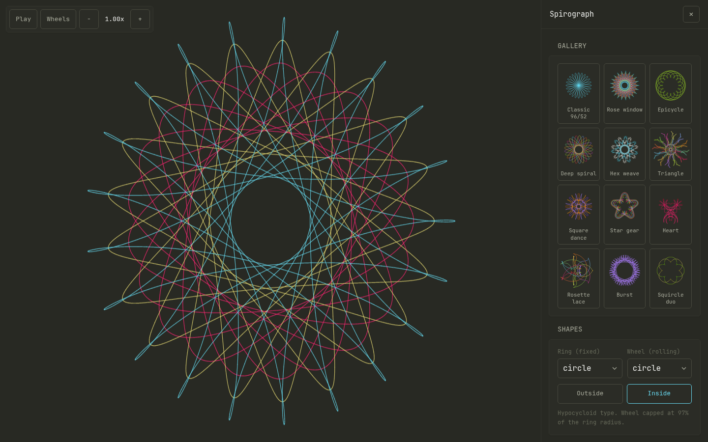
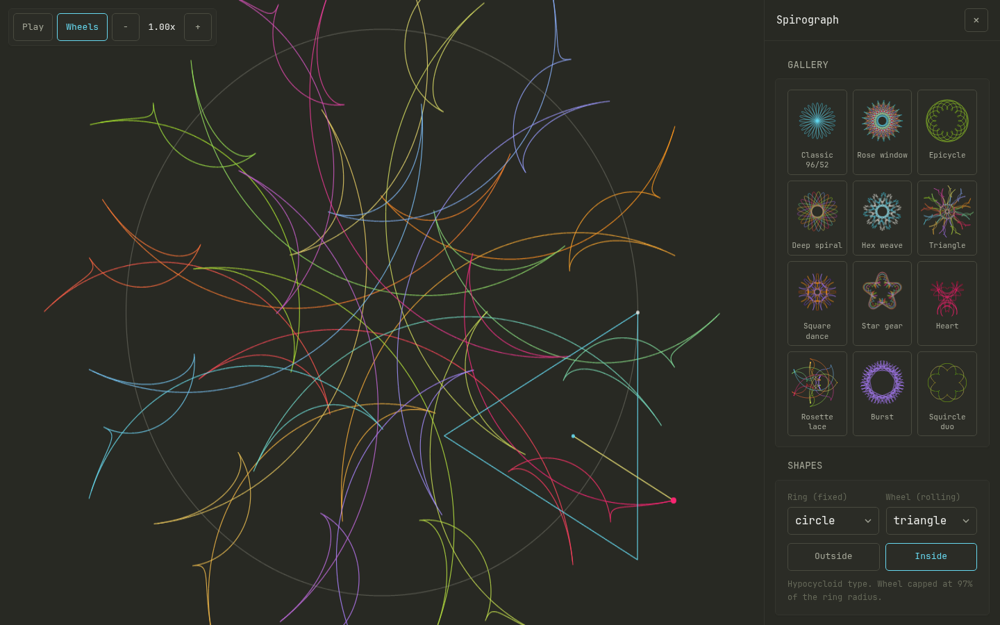
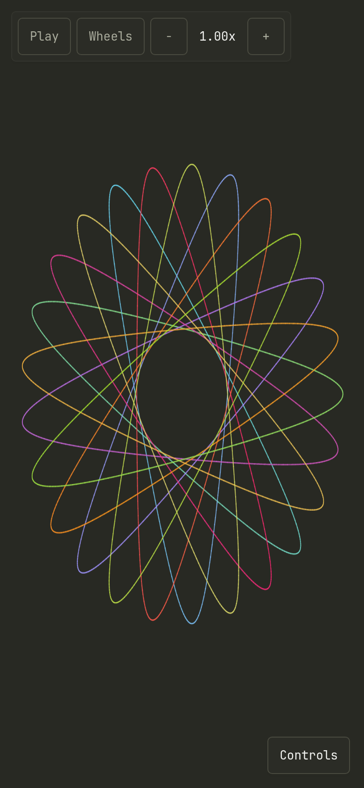

# Spirograph

Live at https://spiro.ianmcmanus.net



| Wheels shown while rolling | Phone |
| --- | --- |
|  |  |

A single-file Spirograph generator. Plain HTML, CSS and vanilla JS. No dependencies, no build step, no server-side state.

Settings are kept in the URL hash, so a reload keeps them and a copied link reproduces the pattern. Drag around the canvas to roll the wheel by hand; scroll or pinch to zoom, Shift-drag or two fingers to pan (0 or Fit resets). Record video restarts the drawing and saves it as a 1080x1080 MP4 (or WebM where MP4 recording isn't supported). Save GIF writes a looping 6 second 480x480 GIF of the whole drawing, encoded in the page. Keys: Space play/pause, W wheels, -/+ speed, D draw, S shuffle, K keep layer, U undo layer, C clear all. Each layer can use one solid Monokai ink or the colour cycle; Rotation turns the whole pattern, for rotated copies across layers. Save SVG writes vector paths for print or pen plotters. Size by Teeth uses the classic kit's tooth counts (rings 96, 105, 144, 150; wheels 24 to 84), so patterns close the way the physical gears do. Dragging backwards erases. Type a name and press Play: a chain of rotating circles (a Fourier series of the letter strokes) writes it out; the Circles slider sets how many (2 to 2000), from a rough sketch to sharp letters. The Gallery loads ready-made layered patterns, and kept layers are included in the link. "Keep layer" freezes the current pattern so the next one draws on top; Save PNG renders every layer at up to 4096 px.

## Cloudflare Pages

The live site is the `site/` directory published to Cloudflare Pages. `site/_headers` sets the same security headers as `nginx.conf`.

## Run locally

```sh
python3 -m http.server 8080 -d site
```

Open http://localhost:8080/.

## Run on the homelab

```sh
docker compose up -d --build
```

Open http://HOST:8080/. The container serves the app at `/`, runs nginx as the unprivileged `nginx` user on port 8080, and has a read-only root filesystem.

`./deploy.sh` wraps the common commands: `build`, `up`, `down`, `logs`, `redeploy` (`docker compose up -d --build`).

## Change the port

Copy `.env.example` to `.env` and set the host port:

```sh
cp .env.example .env
# SPIRO_PORT=9090
```

Then `docker compose up -d`. The default is 8080.

## Check health

```sh
docker inspect --format '{{.State.Health.Status}}' spirograph
```

It prints `healthy` once `/healthz` answers. You can also `curl http://HOST:8080/healthz`.

## Traefik

`docker-compose.yml` contains a commented block. To use it, delete the `ports:` entry, uncomment the `labels:` and `networks:` blocks and the top-level `networks:` entry, and set the hostname, entrypoint and certificate resolver to match your Traefik. The container must share the external Docker network named `proxy` with Traefik.

## Font

`site/JetBrainsMono-Regular.woff2` is JetBrains Mono, under the SIL Open Font License 1.1 (see `site/OFL.txt`). It is served with the page, so the page makes no third-party requests.

## License

Copyright (c) 2026 Ian McManus. MIT, see `LICENSE`. The bundled font is under its own licence, see `site/OFL.txt`.

If you enjoy it, you can [sponsor me on GitHub](https://github.com/sponsors/ianmcman).
