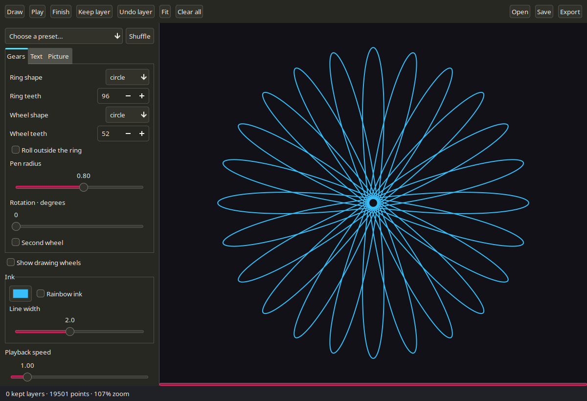
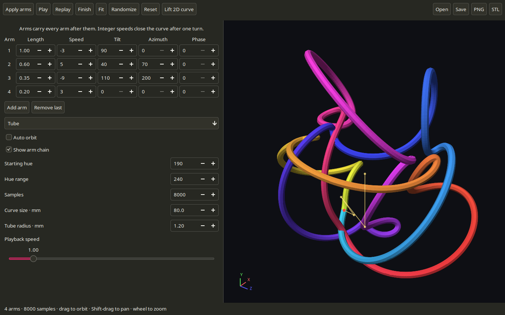
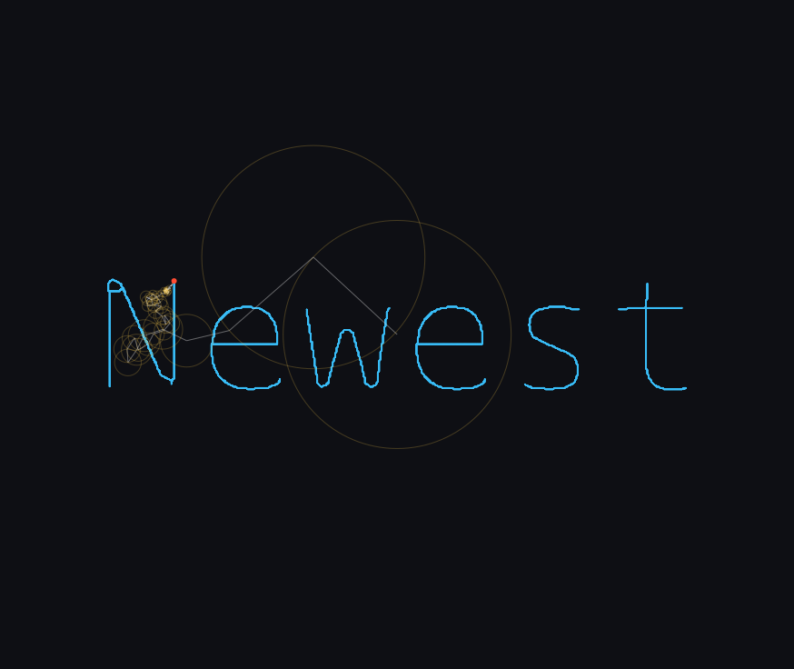

# SpiroLab — native C

A local Linux desktop port of SpiroLab, built with C11, GTK3, Cairo, Pango, GdkPixbuf and ONNX Runtime's C API. Drawing, tracing and inference run on this PC. No browser, JavaScript runtime, Node server or network service is needed.



## Run

```sh
./run.sh
```

Or launch **SpiroLab** from the applications menu after installing the supplied desktop entry template (instructions below). The built executable is `spirolab`. `run.sh` builds it if missing; after changing source, run `make` to rebuild.

```sh
make -j4
./spirolab
```

Install a C11 compiler, Make, pkg-config and the development packages for GTK3, Cairo, Pango, GdkPixbuf, ONNX Runtime and libepoxy. Build flags come from `pkg-config` for `gtk+-3.0 pangocairo cairo-svg cairo-pdf libonnxruntime epoxy`. The default build uses `-O2`.

### Applications menu

From this directory, install a desktop launcher with the current checkout path:

```sh
mkdir -p "$HOME/.local/share/applications"
sed "s|@APP_DIR@|$PWD|g" SpiroLab.desktop > "$HOME/.local/share/applications/spirolab-native.desktop"
```

Repeat this step if you move the checkout. The launcher also provides a **3D Spirograph** action.

## Drawing

- Eleven ring and wheel shapes, inside/outside rolling, tooth counts, pen radius and rotation. Polygon corners use the original rolling/fillet geometry. Round gears use exact analytic equations.
- A second round wheel rolling **inside or outside** the main wheel, with size and orbit-speed controls, plus presets and shuffle. Enable **Second wheel**; check **Second wheel rolls outside** for outside placement.
- Text and picture tracing, with 2–2,097,152 Fourier circles. High circle counts use inverse FFT synthesis. Trace detail is 32–8192 pixels. Gear curves adapt to complexity up to 4,194,305 points; maximum-circle traces reconstruct to 4,194,305 points.
- Play/pause, speed, finish, pointer-centred zoom, pan and fit. Up to 32 kept layers, undo and clear.
- A wheel overlay for round gears and a Fourier overlay showing up to 128 largest circles. The complete drawing uses every selected term.
- Pen lifts between separate letters, facial features and picture strokes, preserved in layers, saves and exports.
- Fixed or rainbow ink, with transparency and line width.
- PNG at 2048 pixels, vector SVG, and A4 PDF. Exports contain the complete design, including kept layers.
- `.spiro` files preserve layers, actual ink, playback position, settings, Fourier coefficients, and embedded source/prepared pictures. Invalid files leave the current document intact. Saves use an atomic replacement. A file is limited to 512 MiB and 8,388,610 total points across the current curve and kept layers.

Settings refresh the drawing automatically after a 250 ms pause in typing or moving a control. Text updates as you type; switching tabs updates the current mode. Changes made during a background trace replace the pending request, and stale results are discarded. Live updates show the complete curve; **Draw** or Enter in the text field restarts animated playback. Presets and Shuffle draw immediately. **Keep layer** freezes the current curve and makes room for another.

## Faces and subject cutout

1. Select **Picture** and **Open image**.
2. Choose **Remove background**, **Subject outline**, **Face drawing**, or **Face + subject outline**.
3. Preparation and tracing start automatically. The preview and status show the result; **Prepare image** can rerun preparation explicitly.
4. Press **Draw** to replay the trace, or **Save PNG** to keep the processed picture. Removed backgrounds remain transparent in the saved PNG.

Face tools start at 8192 circles and 512-pixel detail; adjust those controls if desired. Preparation and tracing run in the background. Images are processed locally and are never uploaded. Large input pictures are reduced to at most 8192 pixels on their longer side. Change the tool to return to the original picture; processing always starts from that original. AI preparation uses at most 4096 pixels; ordinary tracing can use the full 8192-pixel source.

Supply the optional inference models under `models/`: `u2netp.onnx`, `det_500m.onnx`, and `2d106det.onnx`. A full `u2net.onnx` takes precedence if supplied. Model lookup is relative to the executable, so launching from another directory works. Override with `--model-dir DIR` or `SPIROLAB_MODEL_DIR`.

The InsightFace weights retain their non-commercial research restrictions. See [models/README.md](models/README.md); model weights are not covered by the application MIT licence.

## 3D Spirograph

Click **3D Spiro** in the main toolbar, or launch it directly:

```sh
./run.sh --3d
```



- **1,000–4,000,000 samples**, with 32,000 by default. Increase **Samples** and press **Apply arms** for finer curves. Higher counts take longer to generate and export; a 4,000,000-sample STL has 96,000,000 triangles (about 4.8 GB).
- One to sixteen chained arms, each with length, signed integer speed, tilt, azimuth and phase. Press **Apply arms** after editing the arm table.
- **Line** and shaded **Tube** views, automatic orbit, an optional arm-chain overlay, randomization, playback and replay.
- Drag to orbit; Shift-drag, middle-drag or right-drag to pan; mouse wheel to zoom at the pointer. **Fit** recentres the curve. Space plays/pauses, R replays, F finishes, and 0 fits.
- **Lift 2D curve** is available when opened from a gear drawing. It approximates that drawing with up to sixteen strongest Fourier terms and tilts the second arm into 3D. It uses a snapshot of the drawing at the time the window opens.
- **Save/Open** use `.spiro3d` files containing the arms, appearance, export dimensions and camera view. These are separate from 2D `.spiro` documents.
- **PNG** saves a 2048-pixel rendering from the current camera. **STL** exports a closed tube in millimetres, with a consistent winding and a continuous frame around the closing seam. Camera zoom and orbit do not affect STL dimensions.

**Curve size** is the longest side of the centreline bounds; the tube extends by its radius around that centreline. Some arm settings produce crossings or self-intersections, so inspect the STL in your slicer before printing. The software preview uses a reduced mesh for interaction; hardware OpenGL and STL use the selected sample count with twelve vertices around each tube section.

```sh
./spirolab --3d drawing.spiro3d
./spirolab --render-3d /tmp/3d.png drawing.spiro3d
./spirolab --stl-3d /tmp/3d.stl drawing.spiro3d
```

The design filename is optional for headless exports; omitting it uses the default three-arm design. Music-reactive mode and turntable/video export remain separate unported features.

### GPU rendering

[Hardware pressure-test results](docs/3d-pressure-test.md): tested up to eight million points in a disposable build; one to two million remained practical on the RTX 4070 SUPER, while multi-million-point tubes eventually developed stalls. The production limit is 4,000,000; 32,000 remains the default.

The interactive 3D window uses OpenGL 3.3 through GTK's GL area. Curve and tube buffers are uploaded when their geometry changes. Orbiting, panning, zooming, hue changes and playback reuse those buffers; the GPU performs projection, smooth lighting and depth testing. Animation follows the display frame clock. Hardware rendering uses the full selected mesh and up to four-sample antialiasing.

The status bar identifies the active renderer. **GPU · NVIDIA…** means hardware acceleration is active; **OpenGL software · llvmpipe…** means the driver is using the CPU. Software OpenGL uses a lighter tube preview and two-sample antialiasing. STL geometry is unchanged. PNG/headless exports remain available independently through Cairo.

If OpenGL cannot initialize, the viewer falls back to Cairo. For diagnostics, `SPIROLAB_SOFTWARE_3D=1 ./run.sh --3d` explicitly selects that fallback. A driver updated since the PC last booted can prevent hardware contexts from opening; save your work, reboot, and reopen SpiroLab to load matching kernel/user-space components.

```sh
./tests/gpu.sh
```

This display-dependent test reports the actual renderer and redraw timing, verifies that camera changes do not reupload geometry, checks rendered pixels and playback/overlay buffers, and exercises resize and cleanup. `SPIROLAB_GL_FULL_MESH=1` disables the preview reduction when benchmarking a software OpenGL driver.


## High-resolution 2D



The limits above were tested on this PC rather than copied from the web version. [Measurements and renderer comparison](docs/2d-pressure-test.md) cover the maximum-size FFT, text tracing, rendering and saved-document roundtrip. Maximum settings can take several seconds to prepare and require large files. Defaults stay modest. The interactive 2D canvas now uses OpenGL 3.3 with cached stroke buffers, round caps/joins, actual line widths, rainbow ink, pen lifts and transparent layers. Pan/zoom, playback and colour/width changes reuse the geometry. Wheel/Fourier overlays remain available. Animation follows the display frame clock. The status bar identifies the renderer; initialization/allocation failures fall back to Cairo. Force that fallback with `SPIROLAB_SOFTWARE_2D=1 ./run.sh`. PNG/SVG/PDF exports retain full curve geometry through Cairo.

On this RTX 4070 SUPER, the integrated 4,194,305-point stroke renderer measured about 3.6 ms per pan frame, with an initial upload/draw around 47 ms. These timings include completed GPU work and exclude desktop presentation latency. The earlier thin-line prototype timings in the comparison report describe a different rendering path.

```sh
./tests/high-resolution.sh
./tests/desktop-gpu.sh   # Requires a desktop OpenGL session
```

## Controls

| Action | Input |
|---|---|
| Play/pause | Space |
| Draw / finish | D / F |
| Keep / undo layer | K / U |
| Clear all / fit | C / 0 |
| Save / open | Ctrl+S / Ctrl+O |
| Zoom | Mouse wheel |
| Pan | Middle drag or Shift-drag |

Typing in text fields does not trigger drawing shortcuts.

## Headless tools

```sh
./spirolab --render-demo /tmp/design.png
./spirolab --trace-text 'Ian' /tmp/name.png --terms 16384
./spirolab --ai face photo.jpg /tmp/face.png
./spirolab --ai cutout photo.jpg /tmp/cutout.png
./spirolab --ai face-outline photo.jpg /tmp/outline.png
./spirolab --trace-image /tmp/face.png /tmp/face-curve.png --ink --terms 2048
./spirolab --check-design drawing.spiro
```

`--ink` traces clean black strokes directly. Without it, picture tracing extracts edges. The installed GdkPixbuf codecs use a local D-Bus helper for some formats; run image commands in your ordinary desktop session. PNG rendering from curve data requires no display.

## Validation

```sh
make test
./tests/sanitize.sh
SPIROLAB_FACE_FIXTURE=/path/to/test-photo.jpg make test
```

The checks cover analytic geometry, all 242 shape/side combinations, exact closure, rotation, second wheels, Fourier reconstruction, disconnected masks, stable layer colour, export write failures, wheel/curve agreement, saved images and coefficients, and preserving a document after a corrupt load. 3D checks cover chained rotations, closure, mesh edge incidence/winding, analytic torus volume, STL bytes, saved camera/arm settings and export failures. The sanitizer script covers the core engine plus injected allocation failures.

`tests/3d-gui-check.c` drives the real 3D arm/view/playback/lift controls and window cleanup.

`tests/gui-check.c` drives the actual GTK callbacks through gear, text and face jobs, layer actions and closing during inference. It can capture the application's own widgets without capturing the desktop.

For validation we used InsightFace's public [t1.jpg sample](https://github.com/deepinsight/insightface/blob/master/python-package/insightface/data/images/t1.jpg), kept in `/tmp` rather than distributed with the app.

## Port coverage

This is a working native release, not full parity with the web/server application. Still absent: music mode, video/GIF/JPG exports, batch/background render queues, plotter travel optimisation, image-colour matching/splitting, manual gear dragging, browser share links, email and notifications. Face landmarks and subject outlines work; the web version's extra glasses fitting and hair-flow strokes are not ported. The original web application remains separate.

See [PORTING.md](PORTING.md) for architecture and swarm provenance. Four isolated Antigravity/Gemini workers produced initial drafts. After AGY reported exhausted quota, Codex completed integration and corrections with the user's approval. No further AGY calls were made.
